<!-- Перед публикацией: найди и замени <YOUR_HANDLE> на свой GitHub-ник (поиск по файлу). -->
<div align="center">



<br>


</div>

<br>

> Строю инфраструктуру, которую невозможно пробить. Безопасность в каждом шаге — от коммита до рантайма.

<br>

## ▌IDENTITY // MANIFEST

```yaml
apiVersion: astro.sec/v1
kind: CyberneticSecurityEngineer
metadata:
  name: anli
  namespace: astro-core
  labels:
    aesthetic: techwear.cyber-y2k.avant-garde
    era: retro-futurism
    reactor: omega-factor
  annotations:
    clearance: LEVEL_9
spec:
  mission: Строю инфраструктуру, которую невозможно пробить
  principles:
    - zero-trust: доверия по умолчанию нет — ни сети, ни образу, ни мне самому
    - shift-left: безопасность живёт в коммите, а не в отчёте после релиза
    - automate-everything: что можно автоматизировать — автоматизировано, подписано и проверено
    - style-is-engineering: высокая инженерная культура и чувство стиля — одно целое
  coverage:
    commit: [pre-commit, gitleaks, semgrep]
    build: [distroless, trivy, cosign]
    deploy: [argocd, gatekeeper]
    runtime: [falco, cilium, wazuh]
  wardrobe: [techwear, cyber-y2k, avant-garde-streetwear]
status:
  armed: true
  reactor:
    output: 100000hp
    state: stable
  posture: "assume breach · verify everything · ship signed"
```

<br>

## ▌ARSENAL

**⟦ OFFENSIVE & APPSEC // SHIFT-LEFT ⟧**


**⟦ CONTAINER & CLOUD HARDENING ⟧**


**⟦ IaC, CI/CD & GITOPS ⟧**


**⟦ CODE & OS ⟧**


**⟦ SECOPS, TELEMETRY & SIEM ⟧**


<br>

## ▌PIPELINE // FROM COMMIT TO RUNTIME

```text
╔══════════════════════════════════════════════════════════╗
║ 01 ▸ COMMIT                                              ║
║    pre-commit hooks · gitleaks · semgrep                 ║
║    signed commits (gitsign)                              ║
╚═════════════════════════════╤════════════════════════════╝
                              │    ◄ GATE: secret in diff?  → REJECT
                              ▼
╔═════════════════════════════╧════════════════════════════╗
║ 02 ▸ CI · SAST / SECRETS / IaC                           ║
║    semgrep · sonarqube · gitleaks · snyk · checkov       ║
║    unit tests · policy tests                             ║
╚═════════════════════════════╤════════════════════════════╝
                              │    ◄ GATE: HIGH+ finding?  → BUILD FAILS
                              ▼
╔═════════════════════════════╧════════════════════════════╗
║ 03 ▸ DISTROLESS BUILD & COSIGN SIGNING                   ║
║    distroless · non-root · read-only rootfs              ║
║    trivy scan · SBOM · cosign sign                       ║
╚═════════════════════════════╤════════════════════════════╝
                              │    ◄ GATE: unsigned / CVE ≥ HIGH?  → NO PUSH
                              ▼
╔═════════════════════════════╧════════════════════════════╗
║ 04 ▸ GITOPS DEPLOY                                       ║
║    helm → argocd sync                                    ║
║    OPA Gatekeeper admission · cosign verify              ║
╚═════════════════════════════╤════════════════════════════╝
                              │    ◄ GATE: policy violation?  → DENIED
                              ▼
╔═════════════════════════════╧════════════════════════════╗
║ 05 ▸ HARDENED K8S CLUSTER                                ║
║    cilium netpol · istio mTLS · PSS restricted           ║
║    vault secrets · keycloak OIDC                         ║
╚═════════════════════════════╤════════════════════════════╝
                              │    ◄ GATE: drift from Git?  → SELF-HEAL
                              ▼
╔═════════════════════════════╧════════════════════════════╗
║ 06 ▸ eBPF RUNTIME SECURITY                               ║
║    falco rules · wazuh agents                            ║
║    prometheus · loki · grafana alerting                  ║
╚══════════════════════════════════════════════════════════╝
```

<br>

## ▌TERMINAL // TELEMETRY

<div align="center">


<br><br>

&show_icons=true&hide_border=true&bg_color=07080c&title_color=ff0055&icon_color=00f0ff&text_color=e2e8f0&ring_color=00ff66" />
&layout=compact&hide_border=true&bg_color=07080c&title_color=ff0055&text_color=e2e8f0&langs_count=8" />

<br><br>

<sub>secure by default · automate everything · 防衛システム</sub>

</div>
