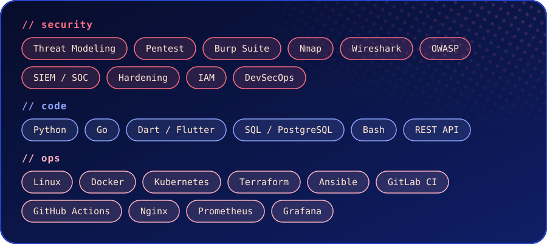

  

### Привет, я Anli 👋

**Инженер информационной безопасности**, который пишет код и автоматизирует инфраструктуру. 
Строю системы, которые трудно взломать и легко поддерживать.

 

 

## 🧭 Чем занимаюсь

- 🛡️ **Безопасность** — моделирование угроз, hardening, анализ защищённости, безопасная архитектура
- 💻 **Разработка** — Python, Go, Flutter; код, безопасный по умолчанию
- ⚙️ **DevOps** — CI/CD, контейнеры, инфраструктура как код, мониторинг

 

  

<picture>
  <source media="(prefers-color-scheme: dark)" srcset="https://raw.githubusercontent.com/bezpaniki-arch/bezpaniki-arch/output/github-snake-dark.svg">
  
</picture>

  

<!--
Контакты — раскомментируй и подставь свои:

-->

